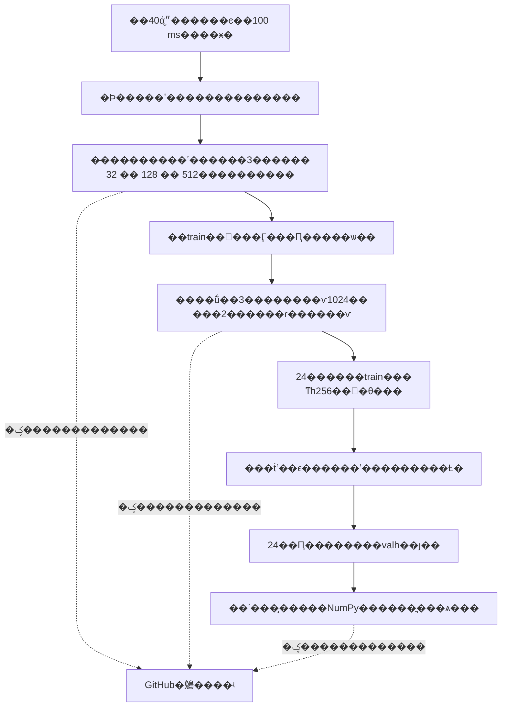

# �����պϷ��̷��֣�������ָ�

ִ�й����[Э��](../reports/closure_discovery_20261017_protocol.md)��[��Դ���](../reports/closure_discovery_20261017_resource_amendment.md)������ڷ���ʮ��40ά�о������ָ�TASK4������ԭ����test��

## �ӿ�

`experiments/symbolic_closure_rom.py` �ṩ `encode / field / rollout / export / from_export`��������ʷΪ `[batch,11,30]`������״̬����Ϊ�ġ��ء�p��q����ʼ����ֻʹ�õ�ǰ״̬�ƽ���ģ���ļ��������ʽ��ϵ�����̶��߶ȡ�ͼ��J/R/B����GRU����Դ���ݡ�

`experiments/discover_closure.py` ִ��A/B/C/D/E������ģ��ֱ������ʽ�ȼۼ�顢�ܿ����⡢����������Ԥ�㸨���������ݡ�����ȷ�Ϻ�NumPy�������������Ǹ�����ʷ���������ۺ�������ʷʵ����ڲ��ġ�



ÿ����ѡͬʱѧϰ����ϵ����һ��GRU��ʼ�����������յ�����ɸѡ��1024����ѵ���ģ�ͳе���ʽ�ṹ�Ƚϣ�����valֻ���ڶ�����ȷ�ϡ��պϷ��̡��ɹ۲�Ԥ�����������ȶ���֤�ݷֱ��жϡ�

## ������ָ�

����Ŀ¼Ϊ `E:/03-nn_Transfer_Func/kiki`��ʹ�� `E:/03-nn_Transfer_Func/kron-reduce/.venv/Scripts/python.exe`������׶�B��

```powershell
& 'E:/03-nn_Transfer_Func/kron-reduce/.venv/Scripts/python.exe' experiments/discover_closure.py B
```

�׶�A��ִ��ʱ��Ҫ�ط�A�������н����B�Ⱥ˶���Դ��ϣ���ɱ���������Ч�׶η����ȷ������·����ʵ�⡣֮������ִ��C��D��E���׶ξ�����root�������������������������ļ������÷��á�

B/Cͬһ·����ָ�ģ�͡��Ż��������״̬���¼������α꼰���¼������Ѿ���ɵ����䲻����ѵ������ֵʧ�ܱ���״̬�ͷ��ã�����Ϊδ����ѡ���������������ʧ�ȣ�Ҳ��ɾ���¼����»��ܡ��ָ����ø����Ѿ��󶨵�Դ�롢������train���ݻ�ģ�ͽṹ����Ҫ�޸��뱣��ԭ�����Ǽ��µ�ǰհ�����

D���ѱ���������͹�ϣ������ɵķ��棬��ͬһģ�ͼ��¼����и�����ɵ����ۡ�����valֻ����ȫ��ģ�͡�ϵ���ͳ�ʼ���������ſ����ɡ����أ������򶳽����ݱ仯��ܾ��ָ����������ɼ�¼����δ�������ܸ��ǡ������������ԡ�

## ֤�������

�����Ϊ `private_data/closure_discovery_20261017/`��`active_job.json` ����ʵ��PID��״̬��`ledger/receipts.jsonl` Ϊ�ۼƽ��̷��ã�`ledger/allocation.json` �DZ���ǰհ�׶η��䡣�жϵĿ�ʼ��¼������ledger�У��ָ�ʱ�˶���ʵ�����ִ������δ֪��ʱ�dz��㡣

ÿ�׶�����Э�顢���ۡ��ؼ����롢���ս�����������ݣ�������GitHub����ʵԶ���ύ��ԭʼ�켣��������ظ��������ڱ��أ���Ҫ�ļ��г�·����SHA256����ʽģ�Ͱ���E�е��������ö���NumPy��ʼ����8���ƽ����ʵ��һ���ԡ�Ԥ�⡢�ṹ֤�����ȶ��������ֱ�ʵ�ʽ��������

�׶�A���ֽڼ�Դ�����λ�� `results/closure_discovery_20261017/implementation/`���嵥Ϊ���е� `identity.json`����ͬʱ���汾��ʵ��ʹ�õ���ʷ����������Ŀ¼��ֹGit�Զ�ת�����С���Ҫ����ʱ�����µļ��Ŀ¼���嵥�ָ���Ӧ���·�����ṩ��ͬ�������ݲ��˶Թ�ϣ����Ҫ���ǵ�ǰ�������޸ĵĹ��������ָ�ͬһ�о�������̳�ʵ�ʷ����ˣ���������Ŀ¼�������ġ�
