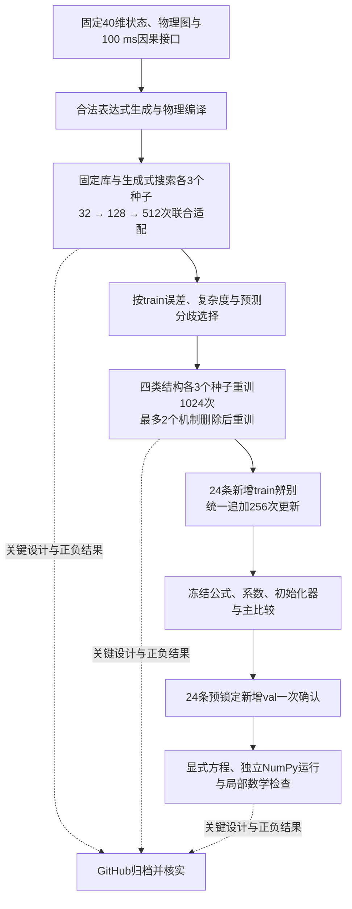

# 物理闭合方程发现：运行与恢复

执行规则见[协议](../reports/closure_discovery_20261017_protocol.md)及[资源变更](../reports/closure_discovery_20261017_resource_amendment.md)。该入口服务十机40维研究，不恢复TASK4，不打开原冻结test。

## 接口

`experiments/symbolic_closure_rom.py` 提供 `encode / field / rollout / export / from_export`；输入历史为 `[batch,11,30]`，对外状态依次为δ、ω、p、q。初始化后只使用当前状态推进。模型文件保存表达式、系数、固定尺度、图与J/R/B方向、GRU和来源身份。

`experiments/discover_closure.py` 执行A/B/C/D/E。配套模块分别负责表达式等价检查、受控问题、有限搜索与预算辅助、新数据、冻结确认和NumPy独立交付。它们复用历史数据与评价函数；历史实验入口不改。



每个候选同时学习方程系数和一次GRU初始化器。搜索终点用于筛选，1024次重训后的模型承担正式结构比较；新增val只用于冻结后的确认。闭合方程、可观测预测与能量／稳定性证据分别判断。

## 启动与恢复

工作目录为 `E:/03-nn_Transfer_Func/kiki`。使用 `E:/03-nn_Transfer_Func/kron-reduce/.venv/Scripts/python.exe`。例如阶段B：

```powershell
& 'E:/03-nn_Transfer_Func/kron-reduce/.venv/Scripts/python.exe' experiments/discover_closure.py B
```

阶段A已执行时不要重放A覆盖已有结果。B先核对来源哈希、成本锁定、有效阶段分配和确认评价路径的实测。C按登记的重训和删除执行单完成。D采用下列分步顺序；全部确认缓存完成后才调用D主入口做只读汇总，再执行E。阶段决定由root结合完整结果作出，不靠更改文件名重置费用。

B/C同一路径会恢复模型、优化器、随机状态、事件覆盖游标及更新计数。已经完成的适配不会再训练。数值失败保存状态和费用，保留为未决候选；不把它标成物理失稳，也不删除事件重新汇总。恢复不得更改已经绑定的源码、依赖、train身份或模型结构；必要修复须保留原件并登记新的前瞻变更。

D按已保存的条件和哈希复用完成的仿真，按同一模型及事件队列复用完成的评价。新增val只有在全部模型、系数和初始化器冻结后才可生成、加载；条件或冻结身份变化会拒绝恢复。部分生成记录保持未决，不能覆盖、换样或暗中重试。

## 本轮D的固定执行顺序

C的14个端点和源码来源已冻结。D使用repair04来源b8d1f961bd5ae7700b8c656b28357b0ad537a77bd838fda5530c4c0c0f4694bc，旧来源与证据保留。以下每一步都先登记准确的源码、模型、条件或数据哈希与脚本哈希，推送GitHub并核实，再运行对应脚本；执行单均在输出根D目录。

1. `data_train_execution_order.json` → `D/run_data_subtask.py --phase train --cap-seconds 8000`，生成并锁定24条新增train。A阶段两个试点包含在这24条中。
2. `discrimination_execution_order.json` → `D/run_discrimination.py --cap-seconds 1800`，只评价冻结C的main2701和alternative2701，所有D适配必须等它结束。此时不得存在D模型、检查点或确认冻结。
3. `parallel_adapt_execution_order.json` → `D/run_parallel_tasks.py --phase adapt --keys ... --cap-seconds ...`，对全部14个C端点各追加256次。最多四个独立进程，键集合互不重叠，累计费用仍受D的43200秒约束。
4. root核对全部端点的256次更新、来源、采样记录和物理检查，写入不可变的`D/confirmation_freeze.json`。原C的qa保留为历史字段，D端点检查单独保存在`endpoint_physics.json`。
5. `data_val_execution_order.json` → 数据脚本`--phase val`，仅在确认冻结存在且哈希通过时生成预锁定的24条新增val。
6. `parallel_evaluate_execution_order.json` → 并行脚本`--phase evaluate`，复用既有val，不训练、不生成FOM。全部缓存完成后调用`discover_closure.py D`，只复用冻结、数据与缓存并计算预登记主比较；不得用成绩调参、换种子或更换结构。

实际脚本路径、PID、命令和恢复位置见输出根`active_job.json`及D的各`*_job_*.json`。尚未完成第1—6步时，不要直接调用D主入口替代这些步骤。数值失败与不合格样本保持显式未决，不以更换条件或去掉失败事件补齐结果。

## 证据与费用

输出根为 `private_data/closure_discovery_20261017/`。`active_job.json` 保存实际PID与状态；`ledger/receipts.jsonl` 为累计进程费用，`ledger/allocation.json` 是本轮前瞻阶段分配。中断的开始记录保留在ledger中，恢复时核对真实命令回执，不将未知耗时记成零。

每阶段整理协议、结论、关键代码、紧凑结果及复现身份，推送至GitHub并核实远端提交。原始轨迹、缓存和重复检查点留在本地；重要文件列出路径与SHA256。正式模型包在E中导出，并用独立NumPy初始化和8秒推进检查实现一致性。预测、结构证据与稳定性声明分别按实际结果交付。

阶段A的字节级源码快照位于 `results/closure_discovery_20261017/implementation/`，清单为其中的 `identity.json`。它同时保存本轮实际使用的历史依赖，快照目录禁止Git自动转换换行。需要复现时，在新的检出目录按清单恢复对应相对路径，提供相同本地数据并核对哈希；不要覆盖当前有其他修改的工作区。恢复同一研究任务还须继承实际费用账，不能以新目录重置消耗。
