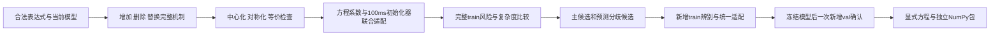

# 阶段A：闭合方程发现首版与执行成本

首版已经将待学习对象从预置模板系数扩展到表达式树、完整机制项的增删替换及合法J/R方向的开关。十机40维状态、物理图、运动学和100ms因果接口保持固定；GRU初始化后由显式ODE自主推进。给定隐藏坐标的节点、边闭合项在无噪声与1%观测噪声下恢复了等价机制。部分观测试验尚未恢复植入的饱和作用，后续研究将分别评价结构、预测和辨别证据。

## 可执行框架

主入口为`experiments/discover_closure.py`，模型为`experiments/symbolic_closure_rom.py`；辅助文件承担表达式等价检查、受控问题、搜索/预算、新数据、冻结确认和独立导出。源码、依赖版本与train身份在正式搜索前绑定；模型保存来源哈希，断点保存优化器、随机状态、采样游标及实际更新数。操作见[运行说明](../docs/closure_discovery_runbook.md)。

原S-O的逐元素向量场重建最大差为2.22e-16，独立NumPy向量场最大差4.66e-15。交换反对称、耗散半正定、完整端口功率恒等式、平衡点、运动学、共同角平移、机器重编号及边方向检查通过。59项针对性检查通过，包括表达式及高阶梯度、来源恢复、数据指纹和冻结确认恢复。

## 受控结构证据

下表是固定模拟坐标上的MSE，分别平均40维向量场或40维自主轨迹；它们不是实测数据的归一化轨迹风险，也不是带单一物理单位的RMSE。前两例提供40维状态及无噪声总RHS标签；1%噪声施加在观测状态，尺度使用该问题固定train标准差。

| 植入机制 | 观测噪声 | 同一机制恢复 | 向量场MSE | 自主轨迹MSE |
|---|---:|---|---:|---:|
| 节点p²q² | 0 | 是 | 1.09e-35 | 5.04e-37 |
| 节点p²q² | 1% | 是 | 1.73e-11 | 7.89e-14 |
| 边(qi−qj)sin角差 | 0 | 是 | 2.11e-34 | 1.60e-34 |
| 边(qi−qj)sin角差 | 1% | 是 | 2.71e-10 | 4.81e-11 |

恢复按中心化、端点交换和非零标量倍的精确等价性判断。边表达式qi·sin角差经交换平均后成为目标形式的一半，因此0.3与目标0.15对应同一方程，不计为两个机制。

部分观测问题由真值ODE生成100ms历史（10×0.01秒）和随后200ms轨迹，只观察前30维，不把q作为目标。六个盲候选各联合适配128次；无噪声与1%噪声下均选择w项，固定30维坐标的train轨迹MSE分别从0.00178205降至0.00169841、从0.00180498降至0.00172074。这项试验没有建立饱和机制恢复或泛化结论，也不能区分有限适配与表示能力的影响。它保留为本轮部分观测问题的未决证据，不据此给模型族下结论。

真值在语法外的有理作用q/(1+|q|)，在两档噪声下最佳合法近似的MSE为0.00099024与0.00100798；没有准确公式恢复声明。受控问题是组件验证，正式生产搜索的重复性和真实数据确认仍由B–D承担。

## 成本与进入B的范围

复杂边项的一轮搜索估价为B 37,392.83秒、C 79,767.50秒、D 36,772.76秒，均含25%余量。D已实测逐事件8秒、三个积分步长和全部指标的评价路径，而非沿用旧模型估价。原阶段分配不能覆盖C；[前瞻资源变更](closure_discovery_20261017_resource_amendment.md)将B的8小时分配给C，总额仍为259,200进程秒，搜索固定一轮。全部对照、三个种子和更新次数保留。

两条已登记新增train条件通过0.005/0.0025秒双步长核验；平衡点、惯性、状态顺序和故障后系统指纹与历史train一致。当前ANDES版本为2.0.0。后续真实FOM逐次记录case哈希、版本、配置与物理指纹，失配保持未决。没有生成或读取新增val，原冻结test关闭。

独立审查提出的D实际成本、有效阶段分配绑定和有符号平方项范围三项问题已修正并记录回应。B将继续研究完整train风险下的主/替代候选，而不是把阶段A解释为已证明部分观测结构发现。模型保留研究候选身份；功率恒等式不构成储能正定性、稳定域或部署证明。

## 关键保留记录

成功组件证据在`private_data/closure_discovery_20261017/A/controlled_causal100ms_v3/`；源模型QA、成本和独立审查同在A下，累计实际进程费用在`ledger/receipts.jsonl`。紧凑公开证据归档到`results/closure_discovery_20261017/A/`。原始轨迹、受控数组、完整真值和检查点留本地并记录哈希。

保留的实现尝试包括：缺失ANDES启动失败、Windows从标准输入启动子进程失败、非法表达式深度、受控未来轨迹起始帧对齐错误、误将历史设为1秒的组件记录、断点未保存参数可训练标志导致的优化器组不匹配，以及未提速而撤回的解析梯度编译实现。相应修复不依据成绩调整设置。早期仅节点项的深度1估价已被完整成本核验替代，不能用来决定执行档位。这些记录不重判为物理失稳或模型族失败。
