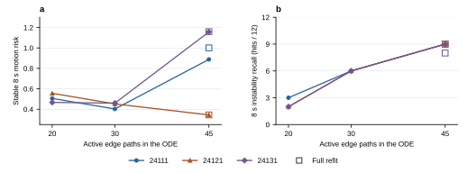

# WP1A · 公平配对的模块消融与边剪枝

**三个种子的去内部耦合组自主召回均为 0/12，Top-30 均为 6/12，完整重拟合保持 8–9/12。**

24 组共接受 3,072 次更新，零拒绝。全体末点通过原始 `val` 的 107/107 条双步长数值核验。原始分母为稳定 95 条、失稳 22 条，其中 12 条失稳具备输入历史。表中风险截断在真实记录内，自主召回单独使用 8 s 推演窗。原父点的评分取自冻结结果，父点推理时间按本轮相同工作量实测。[前瞻协议](../../campaigns/osgkd_v2/wp1a_matched_refit_protocol.md) · [固定评分](../../results/osgkd_v2_wp1a_refits_20261127/evaluate01/summary.json)

## 同预算全量与结构对照

- 三个种子的 `full` 均通过原父点护栏。稳定 8 s 风险分别从 1.1557、0.4309、1.1070 变为 1.0007、0.3444、1.1594。误报和自主召回各自保持，固定参考谱最大实部增加 0.089、0.131、0.050 s⁻¹，均在预登记的 0.15 s⁻¹ 内。三个 `full` 末点均有正谱实部。
- Top-30 的三种子平均稳定风险从 `full` 的 0.8348 降至 0.4380，自主召回从 9/12、9/12、8/12 降至各 6/12。Top-20 的稳定风险均值 0.5095，误报各 0/95，自主召回为 3/12、2/12、2/12。与相同静态项限制的 45 边参照相比，剪枝仍在全部种子上降低召回。
- `no_coupling` 将互易交换置零，45 条环境和隐态相关的边通道仍可用。三个种子的稳定风险均升高至 3.576–4.815。相同预算内自主召回均降为零，正谱实部升至约 1.03–1.10 s⁻¹。该组的 384 次尝试全部裁剪，解释限于此次匹配适配预算。
- `no_memory` 在三个种子上均保持 0/95 误报。相对 `full`，失稳真实区间运动风险均值由 0.3156 升至 0.9184，自主召回为 7/12、5/12、5/12。环境记忆支持本组早期失稳预测。49 维嵌入谱仍包含固定零坐标。
- 删动态调制的种子间结果不同，稳定 8 s 风险为 0.4610、0.4518、1.2415，自主召回为 9/12、7/12、9/12。仅 `no_beta_24111` 的谱最大实部为负（−0.0577 s⁻¹）。冻结机械动态在三种子均增加稳定 8 s 风险，自主召回分别为 11/12、9/12、5/12。模型保留初始机械读出与 40 个演化状态、10 个常量机械状态。
- `24121` 的 `static` 与 `full` 实际约束相同。128 条科学记录与 0/64/128 步的模型、Adam、随机数状态哈希均逐项一致。表中保留其执行回执，科学比较按同一配置理解。[复现回执](../../results/osgkd_v2_wp1a_refits_20261127/duplicate_24121.json)

硬掩码仅作用于共享 ODE，图编码器继续对全连接候选图聚合。Top-30/20 边重合与无条件超几何基线一并报告。支撑一致性和长窗预测的共同收益须分别成立。本轮保留完整与删组端点作为证据，Top-30/20 均保留为取舍点。

连线的 45 边端点为对应静态项限制组，与 Top-30/20 保持相同环境静态项掩码。空心方块为同预算完整重拟合。三个种子的 Top-30 自主召回点均落在 6/12。[绘图入口](../../experiments/osgkd_v2_refits/plot_tradeoff.py)

## Table 3 · 固定末点及两套参照

| 种子方案 | 数值资格 | 稳 1 s | 稳 2 s | 稳 5 s | 稳 8 s | 失稳真实区间风险 | 误报 | 自主召回 | 真实区间检出 | 滞后中位/IQR s | α s⁻¹ | 正模态 | 双步长纯推理 s |
| --- | --- | --- | --- | --- | --- | --- | --- | --- | --- | --- | --- | --- | --- |
| parent_24111 | 107/107 | 0.3571 | 0.4155 | 0.4417 | 1.1557 | 0.3076 | 1/95 | 9/12 · 9/22 | 0/12 | 0.380 / 1.300 | 0.01023 | 2 | 49.164 |
| full_24111 | 107/107 | 0.3464 | 0.4043 | 0.4159 | 1.0007 | 0.3038 | 1/95 | 9/12 · 9/22 | 0/12 | 0.370 / 1.280 | 0.09946 | 1 | 48.963 |
| static_24111 | 107/107 | 0.3531 | 0.4094 | 0.4125 | 0.8878 | 0.3097 | 1/95 | 9/12 · 9/22 | 0/12 | 0.370 / 1.360 | 0.11323 | 1 | 55.384 |
| top30_24111 | 107/107 | 0.3670 | 0.4104 | 0.2922 | 0.4024 | 0.3569 | 1/95 | 6/12 · 6/22 | 1/12 | 0.360 / 0.792 | 0.16890 | 1 | 60.421 |
| top20_24111 | 107/107 | 0.4298 | 0.4767 | 0.4210 | 0.5058 | 0.4144 | 0/95 | 3/12 · 3/22 | 0/12 | 0.430 / 0.215 | 0.15873 | 1 | 60.381 |
| no_beta_24111 | 107/107 | 0.3785 | 0.4333 | 0.3522 | 0.4610 | 0.3253 | 1/95 | 9/12 · 9/22 | 0/12 | 1.540 / 2.630 | -0.05772 | 0 | 49.796 |
| no_memory_24111 | 107/107 | 0.8160 | 0.7983 | 0.5535 | 0.4360 | 0.9756 | 0/95 | 7/12 · 7/22 | 0/12 | 3.730 / 1.795 | 0.00000 | 0 | 55.374 |
| no_coupling_24111 | 107/107 | 0.5069 | 0.5439 | 1.1131 | 3.5760 | 0.4868 | 0/95 | 0/12 · 0/22 | 0/12 | — / — | 1.03103 | 10 | 53.969 |
| frozen_p_24111 | 107/107 | 0.3394 | 0.4157 | 0.6170 | 2.0216 | 0.3291 | 1/95 | 11/12 · 11/22 | 0/12 | 3.840 / 2.745 | 0.18165 | 2 | 51.124 |
| parent_24121 | 107/107 | 0.3604 | 0.4105 | 0.2969 | 0.4309 | 0.3196 | 0/95 | 9/12 · 9/22 | 0/12 | 0.340 / 1.570 | -0.01055 | 0 | 48.756 |
| full_24121 | 107/107 | 0.3507 | 0.3971 | 0.2808 | 0.3444 | 0.3210 | 0/95 | 9/12 · 9/22 | 0/12 | 0.350 / 1.540 | 0.12011 | 1 | 47.458 |
| static_24121 | 107/107 | 0.3507 | 0.3971 | 0.2808 | 0.3444 | 0.3210 | 0/95 | 9/12 · 9/22 | 0/12 | 0.350 / 1.540 | 0.12011 | 1 | 46.710 |
| top30_24121 | 107/107 | 0.3643 | 0.4155 | 0.3277 | 0.4518 | 0.3332 | 0/95 | 6/12 · 6/22 | 0/12 | 0.310 / 0.132 | 0.05799 | 2 | 53.738 |
| top20_24121 | 107/107 | 0.3967 | 0.4528 | 0.3889 | 0.5560 | 0.3713 | 0/95 | 2/12 · 2/22 | 0/12 | 0.680 / 0.330 | 0.06138 | 2 | 53.970 |
| no_beta_24121 | 107/107 | 0.3543 | 0.4005 | 0.2946 | 0.4518 | 0.3342 | 0/95 | 7/12 · 7/22 | 0/12 | 1.710 / 3.645 | 0.14566 | 1 | 49.902 |
| no_memory_24121 | 107/107 | 0.8470 | 0.8369 | 0.6294 | 0.5182 | 0.8688 | 0/95 | 5/12 · 5/22 | 0/12 | 5.230 / 1.940 | 0.00000 | 0 | 56.379 |
| no_coupling_24121 | 107/107 | 0.6527 | 0.7028 | 1.0926 | 4.4902 | 0.8024 | 0/95 | 0/12 · 0/22 | 0/12 | — / — | 1.09451 | 9 | 52.783 |
| frozen_p_24121 | 107/107 | 0.3342 | 0.3914 | 0.6790 | 2.7091 | 0.3451 | 1/95 | 9/12 · 9/22 | 0/12 | 3.760 / 3.180 | 0.16564 | 2 | 50.606 |
| parent_24131 | 107/107 | 0.3927 | 0.4330 | 0.3417 | 1.1070 | 0.3261 | 1/95 | 8/12 · 8/22 | 0/12 | 1.060 / 3.665 | 0.22610 | 1 | 49.166 |
| full_24131 | 107/107 | 0.3813 | 0.4198 | 0.3441 | 1.1594 | 0.3220 | 1/95 | 8/12 · 8/22 | 0/12 | 1.060 / 3.610 | 0.27644 | 1 | 46.949 |
| static_24131 | 107/107 | 0.3892 | 0.4286 | 0.3500 | 1.1570 | 0.3251 | 1/95 | 9/12 · 9/22 | 0/12 | 1.780 / 4.600 | 0.27062 | 1 | 52.524 |
| top30_24131 | 107/107 | 0.4087 | 0.4379 | 0.3299 | 0.4598 | 0.3837 | 0/95 | 6/12 · 6/22 | 0/12 | 0.405 / 3.765 | 0.27708 | 1 | 57.875 |
| top20_24131 | 107/107 | 0.4462 | 0.4811 | 0.3882 | 0.4668 | 0.4123 | 0/95 | 2/12 · 2/22 | 1/12 | 0.485 / 0.485 | 0.20141 | 1 | 57.644 |
| no_beta_24131 | 107/107 | 0.3940 | 0.4350 | 0.3617 | 1.2415 | 0.3178 | 1/95 | 9/12 · 9/22 | 0/12 | 1.640 / 4.700 | 0.14238 | 1 | 50.760 |
| no_memory_24131 | 107/107 | 0.8203 | 0.7980 | 0.5641 | 0.4333 | 0.9109 | 0/95 | 5/12 · 5/22 | 0/12 | 4.360 / 3.160 | 0.00000 | 0 | 56.398 |
| no_coupling_24131 | 107/107 | 0.6115 | 0.6286 | 1.2192 | 4.8152 | 0.8493 | 0/95 | 0/12 · 0/22 | 0/12 | — / — | 1.10382 | 9 | 51.841 |
| frozen_p_24131 | 107/107 | 0.3731 | 0.4207 | 0.4841 | 1.8914 | 0.3972 | 1/95 | 5/12 · 5/22 | 0/12 | 3.570 / 1.390 | 0.15843 | 2 | 50.105 |

## 同口径端口与共同转速

各行按稳定 1/2/5/8 s 及失稳真实区间排列。

| 种子方案 | 共同转速 RMSE（rad/s） | 归一化机械 RMSE | 归一化电气 RMSE |
| --- | --- | --- | --- |
| parent_24111 | 0.2435 / 0.2775 / 0.3299 / 0.3487 / 0.8507 | 0.5130 / 0.4856 / 0.4242 / 0.3416 / 0.9041 | 0.7506 / 0.7028 / 0.4804 / 0.3831 / 1.5746 |
| full_24111 | 0.2364 / 0.2715 / 0.3245 / 0.3453 / 0.8408 | 0.5108 / 0.4843 / 0.4241 / 0.3416 / 0.8986 | 0.7478 / 0.7010 / 0.4791 / 0.3820 / 1.5667 |
| static_24111 | 0.2467 / 0.2780 / 0.3330 / 0.3493 / 0.8533 | 0.5137 / 0.4856 / 0.4252 / 0.3424 / 0.8981 | 0.7497 / 0.7023 / 0.4796 / 0.3824 / 1.5705 |
| top30_24111 | 0.2751 / 0.2967 / 0.3476 / 0.3711 / 0.9098 | 0.4999 / 0.4805 / 0.4245 / 0.3419 / 0.9083 | 0.7501 / 0.6997 / 0.4764 / 0.3800 / 1.6304 |
| top20_24111 | 0.3216 / 0.3370 / 0.3879 / 0.3842 / 1.0097 | 0.4652 / 0.4740 / 0.4201 / 0.3384 / 0.9955 | 0.7461 / 0.7000 / 0.4735 / 0.3789 / 1.7240 |
| no_beta_24111 | 0.2522 / 0.2726 / 0.3176 / 0.3279 / 0.8776 | 0.4912 / 0.4776 / 0.4187 / 0.3370 / 0.9198 | 0.7614 / 0.7116 / 0.4871 / 0.3884 / 1.6073 |
| no_memory_24111 | 0.7084 / 0.6294 / 0.5888 / 0.4971 / 1.6782 | 0.4133 / 0.4741 / 0.4180 / 0.3363 / 1.2532 | 0.7720 / 0.7312 / 0.5188 / 0.4213 / 2.2030 |
| no_coupling_24111 | 0.3691 / 0.3381 / 0.8254 / 1.3387 / 1.1130 | 0.5083 / 0.5351 / 0.4113 / 0.3820 / 1.3941 | 0.7606 / 0.7197 / 0.4831 / 0.3983 / 2.0215 |
| frozen_p_24111 | 0.2050 / 0.3933 / 0.4206 / 0.5011 / 0.7599 | 0.5408 / 0.5478 / 0.6370 / 0.5654 / 1.7544 | 0.7247 / 0.7082 / 0.4951 / 0.4073 / 2.0847 |
| parent_24121 | 0.2424 / 0.2664 / 0.3332 / 0.3997 / 0.8543 | 0.4376 / 0.4613 / 0.4108 / 0.3310 / 0.9793 | 0.7415 / 0.6999 / 0.4781 / 0.3806 / 1.6037 |
| full_24121 | 0.2411 / 0.2621 / 0.3273 / 0.3961 / 0.8521 | 0.4373 / 0.4626 / 0.4111 / 0.3313 / 0.9862 | 0.7387 / 0.6986 / 0.4771 / 0.3796 / 1.6107 |
| static_24121 | 0.2411 / 0.2621 / 0.3273 / 0.3961 / 0.8521 | 0.4373 / 0.4626 / 0.4111 / 0.3313 / 0.9862 | 0.7387 / 0.6986 / 0.4771 / 0.3796 / 1.6107 |
| top30_24121 | 0.2487 / 0.2744 / 0.3413 / 0.4025 / 0.8856 | 0.4350 / 0.4614 / 0.4113 / 0.3318 / 0.9874 | 0.7428 / 0.6985 / 0.4752 / 0.3783 / 1.6296 |
| top20_24121 | 0.2895 / 0.2950 / 0.3556 / 0.3930 / 0.9620 | 0.4281 / 0.4609 / 0.4104 / 0.3310 / 1.0066 | 0.7463 / 0.7031 / 0.4773 / 0.3801 / 1.6786 |
| no_beta_24121 | 0.2508 / 0.2686 / 0.3488 / 0.4075 / 0.8750 | 0.4390 / 0.4595 / 0.4116 / 0.3318 / 0.9666 | 0.7445 / 0.7000 / 0.4785 / 0.3809 / 1.6255 |
| no_memory_24121 | 0.6915 / 0.6162 / 0.6139 / 0.5097 / 1.6281 | 0.4240 / 0.4842 / 0.4239 / 0.3406 / 1.3374 | 0.7858 / 0.7392 / 0.5238 / 0.4259 / 2.1805 |
| no_coupling_24121 | 0.6797 / 0.6824 / 0.6384 / 1.1447 / 1.5538 | 0.5706 / 0.5989 / 0.4373 / 0.3774 / 1.6947 | 0.7998 / 0.7500 / 0.5011 / 0.4133 / 2.3653 |
| frozen_p_24121 | 0.1939 / 0.3164 / 0.3549 / 0.4275 / 0.8333 | 0.5619 / 0.5711 / 0.6343 / 0.5620 / 1.8347 | 0.7452 / 0.7201 / 0.4989 / 0.4032 / 2.1407 |
| parent_24131 | 0.2788 / 0.2877 / 0.3467 / 0.4079 / 0.8540 | 0.4456 / 0.4437 / 0.4013 / 0.3242 / 0.9015 | 0.7510 / 0.6982 / 0.4766 / 0.3798 / 1.5781 |
| full_24131 | 0.2696 / 0.2804 / 0.3398 / 0.3971 / 0.8430 | 0.4453 / 0.4432 / 0.4009 / 0.3241 / 0.8991 | 0.7486 / 0.6963 / 0.4746 / 0.3783 / 1.5750 |
| static_24131 | 0.2766 / 0.2873 / 0.3479 / 0.3984 / 0.8522 | 0.4460 / 0.4437 / 0.4019 / 0.3249 / 0.8961 | 0.7503 / 0.6977 / 0.4760 / 0.3794 / 1.5726 |
| top30_24131 | 0.3329 / 0.3194 / 0.3833 / 0.3916 / 0.9584 | 0.4301 / 0.4421 / 0.4028 / 0.3250 / 0.9187 | 0.7509 / 0.6994 / 0.4772 / 0.3796 / 1.6320 |
| top20_24131 | 0.3513 / 0.3380 / 0.4114 / 0.4051 / 1.0252 | 0.4135 / 0.4437 / 0.4047 / 0.3263 / 0.9698 | 0.7477 / 0.7011 / 0.4764 / 0.3799 / 1.6781 |
| no_beta_24131 | 0.2646 / 0.2765 / 0.3280 / 0.3847 / 0.8391 | 0.4344 / 0.4406 / 0.3976 / 0.3214 / 0.9097 | 0.7512 / 0.6997 / 0.4774 / 0.3804 / 1.5745 |
| no_memory_24131 | 0.7116 / 0.6355 / 0.6076 / 0.5071 / 1.6724 | 0.4138 / 0.4690 / 0.4118 / 0.3313 / 1.2073 | 0.7858 / 0.7377 / 0.5247 / 0.4271 / 2.1662 |
| no_coupling_24131 | 0.6602 / 0.6477 / 0.7351 / 1.4168 / 1.5837 | 0.5435 / 0.5744 / 0.4175 / 0.3855 / 1.6019 | 0.7784 / 0.7341 / 0.4919 / 0.4138 / 2.3573 |
| frozen_p_24131 | 0.1882 / 0.3311 / 0.4329 / 0.5479 / 0.8471 | 0.5355 / 0.5316 / 0.6045 / 0.5283 / 1.8308 | 0.7371 / 0.7119 / 0.5007 / 0.4116 / 2.2021 |

## 同预算适配健康度

| 组 | 尝试 | 接受 | 拒绝 | 裁剪 | 固定首批损失 0→128 | 前末 16 批平均损失 | 投影后更新范数中位 | 末次有限梯度范数 | 停止原因 |
| --- | --- | --- | --- | --- | --- | --- | --- | --- | --- |
| full_24111 | 128 | 128 | 0 | 10 | 0.3384 → 0.3279 | 0.2311 → 0.2796 | 0.00327 | 3.956 | — |
| static_24111 | 128 | 128 | 0 | 10 | 0.3599 → 0.3328 | 0.2491 → 0.2835 | 0.00310 | 3.510 | — |
| top30_24111 | 128 | 128 | 0 | 17 | 0.4006 → 0.3494 | 0.2721 → 0.3212 | 0.00301 | 4.303 | — |
| top20_24111 | 128 | 128 | 0 | 44 | 1.3510 → 0.4244 | 0.5564 → 0.3805 | 0.00357 | 5.280 | — |
| no_beta_24111 | 128 | 128 | 0 | 14 | 0.3897 → 0.3365 | 0.8114 → 0.3041 | 0.00299 | 1.990 | — |
| no_memory_24111 | 128 | 128 | 0 | 19 | 6.6775 → 0.6794 | 2.3005 → 0.5853 | 0.00361 | 0.613 | — |
| no_coupling_24111 | 128 | 128 | 0 | 128 | 13.1870 → 1.5442 | 9.3236 → 1.4661 | 0.00665 | 19.298 | — |
| frozen_p_24111 | 128 | 128 | 0 | 60 | 151.1333 → 0.4800 | 56.1288 → 0.3948 | 0.00492 | 7.729 | — |
| full_24121 | 128 | 128 | 0 | 12 | 0.3244 → 0.3174 | 0.2120 → 0.2758 | 0.00318 | 1.873 | — |
| static_24121 | 128 | 128 | 0 | 12 | 0.3244 → 0.3174 | 0.2120 → 0.2758 | 0.00318 | 1.873 | — |
| top30_24121 | 128 | 128 | 0 | 14 | 0.3531 → 0.3327 | 0.2485 → 0.3044 | 0.00307 | 8.526 | — |
| top20_24121 | 128 | 128 | 0 | 21 | 0.5479 → 0.3675 | 0.3361 → 0.3365 | 0.00245 | 4.602 | — |
| no_beta_24121 | 128 | 128 | 0 | 21 | 0.4551 → 0.3209 | 0.2845 → 0.2841 | 0.00255 | 2.518 | — |
| no_memory_24121 | 128 | 128 | 0 | 25 | 2.7868 → 0.7992 | 1.0128 → 0.6195 | 0.00293 | 1.253 | — |
| no_coupling_24121 | 128 | 128 | 0 | 128 | 19.8752 → 1.7511 | 13.0488 → 1.8144 | 0.00747 | 45.935 | — |
| frozen_p_24121 | 128 | 128 | 0 | 58 | 125.5102 → 0.4320 | 38.6031 → 0.5338 | 0.00558 | 5.245 | — |
| full_24131 | 128 | 128 | 0 | 11 | 0.3467 → 0.3336 | 0.2258 → 0.2859 | 0.00315 | 1.318 | — |
| static_24131 | 128 | 128 | 0 | 9 | 0.3728 → 0.3413 | 0.2311 → 0.2899 | 0.00316 | 1.628 | — |
| top30_24131 | 128 | 128 | 0 | 24 | 0.4978 → 0.3672 | 0.2858 → 0.3575 | 0.00323 | 23.890 | — |
| top20_24131 | 128 | 128 | 0 | 19 | 0.8693 → 0.4025 | 0.3528 → 0.3673 | 0.00274 | 13.173 | — |
| no_beta_24131 | 128 | 128 | 0 | 9 | 0.3886 → 0.3404 | 0.2361 → 0.2874 | 0.00268 | 1.463 | — |
| no_memory_24131 | 128 | 128 | 0 | 16 | 1.6943 → 0.7008 | 0.6929 → 0.5829 | 0.00346 | 1.161 | — |
| no_coupling_24131 | 128 | 128 | 0 | 128 | 17.8653 → 1.4621 | 12.4110 → 1.6722 | 0.00843 | 17.001 | — |
| frozen_p_24131 | 128 | 128 | 0 | 57 | 142.1600 → 0.4970 | 47.4024 → 0.5193 | 0.00584 | 1.696 | — |

## ODE 复杂度

| 组 | 有效参数 | 嵌入维 | 演化维 | 常量机械坐标 | 互易边 | 调制边 | 有效边通道 | 有效模块 |
| --- | --- | --- | --- | --- | --- | --- | --- | --- |
| full_24111 | 2608 | 50 | 50 | 0 | 45 | 43 | 45 | 8 |
| static_24111 | 2588 | 50 | 50 | 0 | 45 | 44 | 45 | 6 |
| top30_24111 | 2408 | 50 | 50 | 0 | 30 | 30 | 30 | 6 |
| top20_24111 | 2288 | 50 | 50 | 0 | 20 | 20 | 20 | 6 |
| no_beta_24111 | 2563 | 50 | 50 | 0 | 45 | 0 | 45 | 7 |
| no_memory_24111 | 2358 | 50 | 40 | 0 | 45 | 44 | 45 | 7 |
| no_coupling_24111 | 2518 | 50 | 50 | 0 | 0 | 0 | 45 | 6 |
| frozen_p_24111 | 2568 | 50 | 40 | 10 | 45 | 45 | 45 | 7 |
| full_24121 | 2608 | 50 | 50 | 0 | 45 | 44 | 45 | 8 |
| static_24121 | 2608 | 50 | 50 | 0 | 45 | 44 | 45 | 8 |
| top30_24121 | 2428 | 50 | 50 | 0 | 30 | 30 | 30 | 8 |
| top20_24121 | 2308 | 50 | 50 | 0 | 20 | 20 | 20 | 8 |
| no_beta_24121 | 2563 | 50 | 50 | 0 | 45 | 0 | 45 | 7 |
| no_memory_24121 | 2358 | 50 | 40 | 0 | 45 | 43 | 45 | 7 |
| no_coupling_24121 | 2518 | 50 | 50 | 0 | 0 | 0 | 45 | 6 |
| frozen_p_24121 | 2568 | 50 | 40 | 10 | 45 | 45 | 45 | 7 |
| full_24131 | 2608 | 50 | 50 | 0 | 45 | 36 | 45 | 8 |
| static_24131 | 2588 | 50 | 50 | 0 | 45 | 35 | 45 | 6 |
| top30_24131 | 2408 | 50 | 50 | 0 | 30 | 24 | 30 | 6 |
| top20_24131 | 2288 | 50 | 50 | 0 | 20 | 13 | 20 | 6 |
| no_beta_24131 | 2563 | 50 | 50 | 0 | 45 | 0 | 45 | 7 |
| no_memory_24131 | 2358 | 50 | 40 | 0 | 45 | 41 | 45 | 7 |
| no_coupling_24131 | 2518 | 50 | 50 | 0 | 0 | 0 | 45 | 6 |
| frozen_p_24131 | 2568 | 50 | 40 | 10 | 45 | 43 | 45 | 7 |

## 跨种子基准刚度阳性边支撑

| 组 | 种子对 | 边数 A | 边数 B | 交集 | Jaccard | F1 | 随机 Jaccard 期望 | 随机 F1 期望 |
| --- | --- | --- | --- | --- | --- | --- | --- | --- |
| frozen_p | 24111/24121 | 45 | 45 | 45 | 1.0000 | 1.0000 | 1.0000 | 1.0000 |
| frozen_p | 24111/24131 | 45 | 45 | 45 | 1.0000 | 1.0000 | 1.0000 | 1.0000 |
| frozen_p | 24121/24131 | 45 | 45 | 45 | 1.0000 | 1.0000 | 1.0000 | 1.0000 |
| full | 24111/24121 | 45 | 45 | 45 | 1.0000 | 1.0000 | 1.0000 | 1.0000 |
| full | 24111/24131 | 45 | 45 | 45 | 1.0000 | 1.0000 | 1.0000 | 1.0000 |
| full | 24121/24131 | 45 | 45 | 45 | 1.0000 | 1.0000 | 1.0000 | 1.0000 |
| no_beta | 24111/24121 | 45 | 45 | 45 | 1.0000 | 1.0000 | 1.0000 | 1.0000 |
| no_beta | 24111/24131 | 45 | 45 | 45 | 1.0000 | 1.0000 | 1.0000 | 1.0000 |
| no_beta | 24121/24131 | 45 | 45 | 45 | 1.0000 | 1.0000 | 1.0000 | 1.0000 |
| no_coupling | 24111/24121 | 0 | 0 | 0 | — | — | — | — |
| no_coupling | 24111/24131 | 0 | 0 | 0 | — | — | — | — |
| no_coupling | 24121/24131 | 0 | 0 | 0 | — | — | — | — |
| no_memory | 24111/24121 | 45 | 45 | 45 | 1.0000 | 1.0000 | 1.0000 | 1.0000 |
| no_memory | 24111/24131 | 45 | 45 | 45 | 1.0000 | 1.0000 | 1.0000 | 1.0000 |
| no_memory | 24121/24131 | 45 | 45 | 45 | 1.0000 | 1.0000 | 1.0000 | 1.0000 |
| static | 24111/24121 | 45 | 45 | 45 | 1.0000 | 1.0000 | 1.0000 | 1.0000 |
| static | 24111/24131 | 45 | 45 | 45 | 1.0000 | 1.0000 | 1.0000 | 1.0000 |
| static | 24121/24131 | 45 | 45 | 45 | 1.0000 | 1.0000 | 1.0000 | 1.0000 |
| top20 | 24111/24121 | 20 | 20 | 16 | 0.6667 | 0.8000 | 0.2895 | 0.4444 |
| top20 | 24111/24131 | 20 | 20 | 17 | 0.7391 | 0.8500 | 0.2895 | 0.4444 |
| top20 | 24121/24131 | 20 | 20 | 18 | 0.8182 | 0.9000 | 0.2895 | 0.4444 |
| top30 | 24111/24121 | 30 | 30 | 28 | 0.8750 | 0.9333 | 0.5021 | 0.6667 |
| top30 | 24111/24131 | 30 | 30 | 27 | 0.8182 | 0.9000 | 0.5021 | 0.6667 |
| top30 | 24121/24131 | 30 | 30 | 27 | 0.8182 | 0.9000 | 0.5021 | 0.6667 |

## 执行与决定

全部 24 组使用同一 128 批序列，覆盖完整 `train` 的 385 条，先完成 `24111` 再释放两个种子。资格仅核固定首批的一条稳定和一条失稳，用 0.01/0.005 s 粗细步长，数据目标，零更新。每组固定 128 次尝试，空 Adam、短热身和余弦倍率，裁剪 5。866 次更新发生裁剪；固定首批起止损失均有下降，降幅 2.15%–99.68%。同一评估窗的首末批和更新范数列于表内，用于判断当前适配量。训练合计约 201.1 分钟墙钟，原始 `val` 一次性评分约 24.2 分钟。谱沿用 49 维去公共角、保留共同转速的接口，自动微分与两档有限差分复核全部通过。

- **代码** 保留叶参数优化器、精确掩码与原配对评分实现。
- **模型** 保留各固定端点作为机制证据。采用状态为 `default none`。
- **科学** 保留内部互易交换和环境记忆的匹配预算证据。Top-30/20 的稳定风险与失稳召回存在取舍，无法按本次结果晋升为普遍保真剪枝。动态调制的贡献随种子变化，按完整配对结果报告。

`test` 事件轨迹访问为 0，新 FOM 为 0。[Table 1](../osgkd_v2_sprint2a_20261125/result.md) · [Table 2](../osgkd_v2_sprint2b_baselines_20261126/result.md) · [训练回执](../../results/osgkd_v2_wp1a_refits_20261127/fit_summary.json) · [独立复核](review.md)
