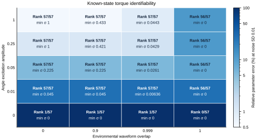

# Layer 1 · 激励与开放端口的可辨识边界

**同步平衡与纯幅值初态对 56 个边参数的灵敏度均为零。同频补偿可在总电气作用完全相同的情况下减少一条真实支撑边。**

| 对照 | 被估计参数数 | 代数秩 | 零空间维数 | 可观测差异 |
| --- | ---: | ---: | ---: | --- |
| 同步平衡 | 56 | 0 | 56 | 运动右端严格为零 |
| 纯幅值初态 | 56 | 0 | 56 | 幅值衰减，运动及全部边力严格为零 |
| 同频补偿 | 20 | 8 | 12 | 12 条边变为 11 条，观测最大绝对差低于 $10^{-14}$ |

前两项是独立 NumPy 生成方程的精确解。第三项给定 $y(t)=(Ac+q)f(t)$，将边力变化 $A\Delta c$ 转入环境项 $-A\Delta c$，适用该总转矩观测算子。所有最小范数求解使用同一固定噪声方向及 0、0.01、0.03 三档噪声。等价类参数误差相对于其中一个真值代表。

相图的 20 格使用同样 66 组已知状态和 57 个参数，包含 28 个 $c$、28 个 $\beta$ 与 1 个环境系数。角激励为零的四格中边参数均不可见。信号非零且环境波形不完全重合的 12 格均为满秩。以激励 0.01 为例，环境波形重合度从 0 到 0.999，最小奇异值由 0.0450 降至 0.00636。重合度到 1 时，四个非零激励格都缺失一个方向。颜色为标准差 0.01 的一次固定噪声下的最小范数相对参数误差。该图检验已知 $\theta,a$ 的观测条件。实际部署只输入短时运动历史。

两机反例的无界核在 $z=16$ 的到达时间为 0.761924409 s，剩余尾长解析上界为 $1.972\times10^{-7}\ \mathrm{s}$。数值求积在两档网格间一致。相同构造的有界核可积分至 2.251938394 s，末态为 1.156408173。开放功率恒等式、线性增长与有限时间反例的适用域见方法稿。[方法与理论](../../paper/osgkd_v2_methods_and_theory.md) · [机器回执](../../results/osgkd_v2_wp2_layer1_20261127/controls.json)

相图由 20 格原始数据生成，SVG/PDF 中保留可编辑文字。PDF 的最小字体为 8 pt，布局碰撞检查通过。零参数更新、零新 FOM、零 IEEE39 轨迹访问。[绘图入口](../../experiments/osgkd_v2_wp2_layer1_20261127/plot_identifiability.py)
