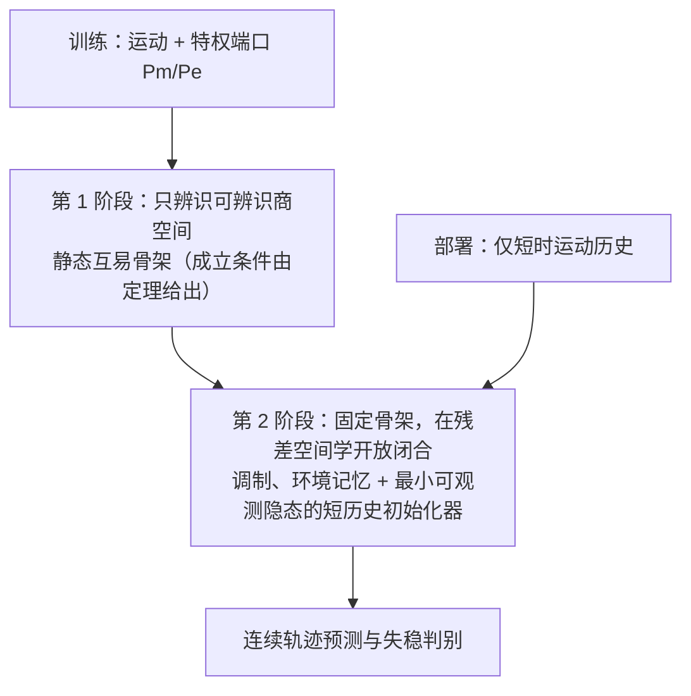

# OSGKD 面向 ICML 类顶会的问题定位：调研与评估

> 范围：评估"电力系统 → 藏本（Kuramoto）模型 → 物理 AI / 系统 ODE 识别"这条推广思路，以及 OSGKD 问题设计是否适合投 ICML/NeurIPS/ICLR。依据是项目现有证据（截至 2026-11-28 的 v2 封卷）和公开文献检索。
> 文献信息来自检索摘要和已有知识，引用前请逐条核对年份和发表处（标 † 的需要优先核对）。

## 0. 结论

1. **"推广到藏本模型"在审稿人看来不算推广。** 带惯性的二阶 Kuramoto 模型就是摇摆方程（Filatrella 2008；Dörfler & Bullo 2012）。把母线换成振子，ML 审稿人会认为这还是"电力系统方法换了个名字"，并且在 ML 圈里 Kuramoto 只是 NRI 系列的玩具基准。
2. **OSGKD 目前把五个 ML 子问题捆在一起**：部分观测、开放系统、短历史初始化、结构识别、长时或失稳预测。顶会论文通常只讲清一个问题。项目里的实验已经说明，捆在一起时各模块会互相补偿，最后哪一项都很难归因。
3. **真正有普适价值、文献里也比较空的点，不在 Kuramoto 本身**，而在下面这个设定：
   > **训练时有特权物理观测（端口力或功率、更全的状态），部署时只有短时部分观测。在这种信息不对称下，网络化开放动力学的哪些结构可以辨识？怎样设计只学可辨识部分的算法？**
   这个问题跨领域：机器人训练时有力传感器、部署时没有；生物和神经科学里训练时有侵入式测量；电网训练时有仿真端口量、运行时只有 PMU 运动量。项目现有的可辨识性负对照（同频补偿等价类、零灵敏度、内部与环境不可分）可以直接作为这个方向的理论起点。
4. **建议**：保留 OSGKD 的物理骨架，但把论文核心问题换成"特权信息下的可辨识性 + 只学可辨识量的分层算法"。"失稳感知"作为说明结构为什么重要的关键实验。电力系统作为旗舰应用放在应用节，不当头条。

---

## 1. 推广链条逐环审视

| 环节 | 判断 | 理由 |
|---|---|---|
| A → B | 等价改写，不是推广 | 摇摆方程本来就是非均匀二阶 Kuramoto；Kron 约化与 Dörfler–Bullo 的工作已经把两者打通 |
| B → C | 有一定一般性 | 隐态、开放端口、记忆也出现在机械网络、神经群体模型、约瑟夫森结阵列、多机器人系统中，但仍属于"网络化二阶振子"这一族 |
| C → D | 目前没有证据 | 物理 AI 或通用 ODE 识别需要跨方程族的证据（如 ODEBench、多物理域）。现有证据只覆盖同模板在摆阵上的重拟合，冻结权重迁移失败（0/3） |

**要点**：审稿人眼里的"普适"，指的是**问题设定和推断原则普适**，而不是换一个物理系统。应该把"开放 + 部分观测 + 特权监督"作为抽象设定，Kuramoto、摆阵、电网都只是它的实例。

## 2. 文献地图与威胁评估

| 研究线 | 代表工作 | 解决什么 | 与 OSGKD 的重叠 | 对新颖性的威胁 |
|---|---|---|---|---|
| 交互图推断 | NRI（Kipf+ ICML'18，用 Kuramoto 作基准）；dNRI（Graber & Schwing CVPR'20）；Amortized Causal Discovery（Löwe+ CLeaR'22，跨系统摊销推断，含 Kuramoto）† | 从轨迹推断交互图，同时做预测 | "结构 + 预测"的主张 | **高**：Kuramoto 结构恢复是它们的主场 |
| 物理界网络重建 | Timme PRL'07；ARNI（Casadiego+ Nat Commun'17）；Panaggio+ Chaos'19；Malizia+ Nat Commun'24（高阶交互） | 回归、压缩感知重建耦合拓扑 | 静态边恢复 | **高**：完全观测下基本已解决；项目 Layer 1 中弱式回归 F1 = 1.000 正好印证 |
| 交互核学习理论 | Lu, Maggioni, Tang PNAS'19 / JMLR；Li, Lu+ 可辨识性 | 非参数交互核，用强制性（coercivity）条件刻画可辨识性 | 耦合函数的可辨识条件 | 中：是**理论上可以借鉴的模板**，而不是竞品 |
| 稀疏方程发现 | SINDy；Weak SINDy（Messenger & Bortz'21）；SINDy-AE（Champion+ PNAS'19）；Deep delay AE（Bakarji+ 2022/23）；ODEFormer（ICLR'24） | 符号方程，包括部分观测加时滞嵌入 | 有限字典、删组 | 中高：部分观测下的方程发现已有一条完整路线 |
| 结构保持网络 | HNN、LNN；Dissipative SymODEN；PHNN（Desai+ PRE'21）；LGNN/HGNN 基准（Thangamuthu+ NeurIPS'22 D&B）；**Gruver+ ICLR'22：HNN 的收益主要来自二阶结构，而不是辛性** | 能量、耗散、端口结构 | 开放功率恒等式、互易势 | **高**：单讲"端口哈密顿 + 图"已不新。Gruver 的结论还提示，"物理结构为什么有用"需要做精确的消融 |
| 端口哈密顿 GNN | PH-DGN（Heilig+ ICLR'25） | 把 pH 结构用作 GNN 架构偏置 | 名字和形式相近 | 低：任务不同，但需要在文中区分 |
| 隐态动力学与初始化 | Latent ODE（Rubanova+ NeurIPS'19）；Neural CDE；数据驱动 Mori–Zwanzig | 短历史编码隐初态、记忆闭合 | 图 GRU 初始化器、环境记忆 | 中：初始化器本身不构成贡献 |
| ODE 可辨识性 | Stanhope+ SIADS'14（单轨迹线性 ODE）；Qiu+ 2022；**Wang+ NeurIPS'24：带隐混杂的线性 ODE 可辨识性**†；稀疏线性 ODE 不可辨识性† | 单轨迹、隐变量条件下能否唯一辨识 | 项目的同频等价类、零灵敏度 | 低，且是**机会**：ML 顶会正在接收这类工作，但非线性、网络化、开放系统几乎空白 |
| 跨环境泛化 | LEADS（NeurIPS'21）；CoDA（ICML'22）；ODEFormer、Panda（2025）† 等动力学基础模型 | 跨系统共享加环境自适应 | 跨规模、跨领域迁移 | 中高：用"迁移"做卖点必须和这些方法比，而 OSGKD 的冻结迁移已经失败 |
| 稳定性学习 | Manek & Kolter NeurIPS'19；神经 Lyapunov 和吸引域证书 | 学习可证稳定的动力学 | L2 稳定性分析 | 中：如果走"失稳感知"路线，需要对比 |
| 电力 ML | PINN 摇摆方程（Stiasny, Misyris, Chatzivasileiadis）；GNN 吸引域稳定性（Nauck+ NJP'22, Chaos'23）；PowerGraph（NeurIPS D&B） | 电网代理模型、暂态稳定评估 | IEEE39 实验 | 对 ML 顶会是应用参照，不是方法竞品 |
| 命名冲突 | AKOrN：Artificial Kuramoto Oscillatory Neurons（ICLR'25）† | 把 Kuramoto 振子当作神经元 | 关键词相同 | 低，但标题和摘要要避免混淆 |

## 3. OSGKD 哪些不新，哪些可能新

**难以作为贡献（已有先例，或项目证据不支持）**
- 二阶 Kuramoto 或摇摆方程的结构先验。
- 开放功率恒等式和端口哈密顿记账（PHNN、Dissipative SymODEN 已有）。
- 图编码器做短历史初始化（Latent ODE 范式）。
- 有限字典加删组重拟合（SINDy 范式）。项目中它还输给了弱式回归。
- 跨规模或跨领域冻结迁移（摆阵 0/3，不如随机冻结编码器）。

**可能新，并且项目已有资产支撑**
1. **网络化开放振子在部分观测下的可辨识性**：同频补偿下的精确等价类（12 条边与 11 条边观测相同）、同步态与纯幅值态零灵敏度、"只有总电气标签时内部与环境不可分"、激励相图分出满秩、近简并和等价三类。目前是经验或构造性结果，**可以提升为定理**。
2. **特权监督的信息结构**：训练时可用端口量（Pm、Pe），部署时只有 100 ms 运动。这对应 ML 中的 *learning using privileged information*（Vapnik 的 LUPI）。把它放到动力学辨识里，并给出"特权通道恢复可辨识性"的结论，检索中没有看到直接的先例。
3. **低 MSE ≠ 保持定性行为**：黑箱 Neural ODE 稳定误差最低，但在验证集和留出集的失稳检出都是 0（0/12、0/9）；删掉耦合或环境模块后检出同样归零。这和"学到的动力学应当保持吸引域和分岔结构"这一 ML 关切相连。但目前样本量小，还需要跨系统验证。

## 4. 问题设计本身的问题

| # | 问题 | 影响 | 来自项目的证据 |
|---|---|---|---|
| P1 | 一个模型同时承担五个子问题 | 模块互相补偿，无法归因，审稿人难以抓住贡献 | EAVI 精修使历史残差降 98% 但未来风险变差约 44 倍；耦合与环境梯度冲突；删动态调制的效应随种子摇摆（冻结机械状态检出更多但滞后 4.7–5.6 s，**不能**解读为机械动态多余） |
| P2 | 用 Kuramoto 作推广载体 | 被视为同族改写；在 NRI 主场竞争 | Layer 1 中弱式回归完胜 |
| P3 | 结构识别的难点放错了位置 | 完全观测下回归已经足够；部分观测下又不可辨识，却没有用理论框定 | 开放工况调制边 F1 = 0 |
| P4 | 基线不符合 ML 惯例 | 缺 NRI/ACD、SINDy-AE、HNN/PHNN/LGNN、Latent ODE、CoDA、ODEFormer，以及直接分类器和 seq2seq 基线 | 目前只有 Neural ODE、封闭 Kuramoto、弱式回归 |
| P5 | 指标太特殊 | risk = 0.8 均值 + 0.2 尾部、"8 s 自主召回"让 ML 读者难以对照 | 建议补标准指标：多时域 MSE、有效预测时间（VPT）、结构 AUROC/AUPRC、分类 AUROC |
| P6 | 主数据私有，规模小 | 可复现性和规模受质疑 | IEEE39 只有 10 机，失稳留出 9 条；合成实验 N ≤ 32 |
| P7 | 卖点和证据错位 | "迁移、物理 AI"没有证据，"可辨识边界、机制必要性"有证据却没当头条 | 见上一轮审查 |

## 5. 候选重构方案

### 方案 A：理论主导——开放网络化振子在部分观测下的可辨识性
- **问题**：给定观测算子（只有运动、运动加总端口、运动加分端口）和激励类别，刻画网络化开放二阶系统中可辨识的商空间。
- **贡献**：(i) 定理：内部与环境可分的充要条件；同频补偿等价类的维数（与图的环空间或关联矩阵的秩相关）；耦合核的强制性条件（借鉴 Lu–Maggioni）。(ii) 算法：只参数化可辨识的商空间，对等价类给出集合或后验，而不是点估计。(iii) 实验：在 Kuramoto、摆阵、神经群体模型上验证"理论预测哪里会失败，就在哪里失败"。
- **优点**：最能复用现有资产（负对照、激励相图、两机逃逸反例）；和 NeurIPS'24 的隐混杂可辨识性工作同一赛道，但推广到非线性、网络化、开放系统。
- **风险**：需要真正的定理深度，3.5 KB 的方法稿远远不够；算法部分需要能量化的收益。

### 方案 B：方法主导——带特权物理监督的分层辨识（推荐作为主线）

> 修订（2026-11-28 评审后）：第 1 阶段**不**声称能线性辨识调制 `a(t)` 和环境记忆 `e(t)`，这两者在特权端口下仍是隐态。原第 3 层的等价类后验采样移到 Future Work，正文只用多种子集成作为不确定性的廉价代理。
- **核心主张**：特权物理通道让结构变得可辨识（给出定理）；分层后避免了端到端联合拟合中的模块互相补偿；部署时只保留可观测的隐态。
- **对照**：端到端 OSGKD（即现有 v2，正好作为消融）、Latent ODE、NRI/ACD、SINDy-AE、PHNN/LGNN，以及不使用特权信息的同架构。
- **优点**：设定跨领域、ML 读者容易理解；现有 v2 的失败自然成为动机（"端到端为什么不行"）；能直接解决上一轮审查指出的根本问题 1–3。
- **风险**：第 1 层很可能就是"弱式回归"，需要说明创新在于信息结构和组合方式，而不是单个模块。

### 方案 C：评测主导——学到的动力学是否保持失稳和吸引域结构
- **问题**：在多个系统（带惯性的 Kuramoto、摆阵、电网等）上，低轨迹误差的模型是否保持定性稳定行为？
- **形式**：基准加指标加机制型模型，可投 NeurIPS D&B 或作为 B 的核心实验。
- **风险**：现有信号样本小（3/9 对 0/9）；需要在合成系统上做出大样本、有统计效力的结论；结论也可能被"直接分类器就够了"推翻，所以必须先做这个基线。

### 不建议的方向
- 继续把 OSGKD 作为"一体化"方法，只靠加系统、加种子去堆证据。
- 往"物理基础模型"或"零样本迁移"方向走。和 Panda、ODEFormer、CoDA 正面竞争，而现有证据是反向的。

## 6. 推荐组合与路线

**主线 = B（方法）+ A 中一到两条核心定理（支撑 B 的可辨识主张）+ C 作为关键实验。**

| 阶段 | 内容 | 产出 | 复用的现有资产 |
|---|---|---|---|
| 1. 问题与理论 | 形式化特权信息下的观测算子；证明内部与环境可分性、等价类维数、耦合强制性条件 | 两到三个定理加证明草稿 | identifiability 报告、负对照、激励相图 |
| 2. 合成基准 | 带惯性 Kuramoto（N 从 8 到 100 以上）、摆阵、外加一个非电力族（如神经群体模型或机械弹簧网络）；控制开放程度、隐态维数、激励强度 | 公开生成器加标准划分 | Layer 1 和摆阵生成器 |
| 3. 算法与基线 | 两阶段算法；基线全量对齐 ML 惯例；补直接分类器和 seq2seq | 主结果表、消融 | v2 实现（作为端到端消融） |
| 4. 定性行为实验 | 失稳感知与吸引域保持，用合成大样本得出有统计效力的结论 | C 的核心图 | 失稳判据、双步长资格框架 |
| 5. 电网应用 | IEEE39 作为高阶系统应用；现有留出结论按"探索性"报告 | 应用节 | 现有 v2 封卷证据 |
| 6. 写作 | 新稿，旧 grid-transient-rom 稿归档 | 投稿稿件 | 主张台账 |

**时间判断**（会议日期以官方公告为准）：ICML 2027 的截稿通常在 1 月底，距今约 8–9 周。方案 B 的理论加完整基线做到投稿质量**非常紧**。比较现实的是以 NeurIPS 2027（约 5 月）为主目标，ICML 2027 只在阶段 1–3 进展顺利时冲刺。

## 7. 需要你决定的事

1. **主线选择**：B（推荐）、A 还是 C？
2. **"特权监督"定位**：训练期使用端口标签，是作为方法核心卖点，还是继续作为辅助监督？这会决定论文的问题陈述。
3. **新合成基准的授权**：按 AGENTS 规则，新增合成科学基准属于待授权事项。阶段 2 需要你明确授权（不涉及新 FOM 和 IEEE39 test）。
4. **目标会议**：ICML 2027 冲刺，还是 NeurIPS 2027 为主？

> [!IMPORTANT]
> 以上是规划和定位建议。按项目规则，进入新架构前需要先写[架构简报](file:///e:/03-nn_Transfer_Func/kiki/templates/architecture_brief.md)，由 Scientist 给出有界设计、Reviewer 挑战。本报告不构成任何训练或数据授权。
